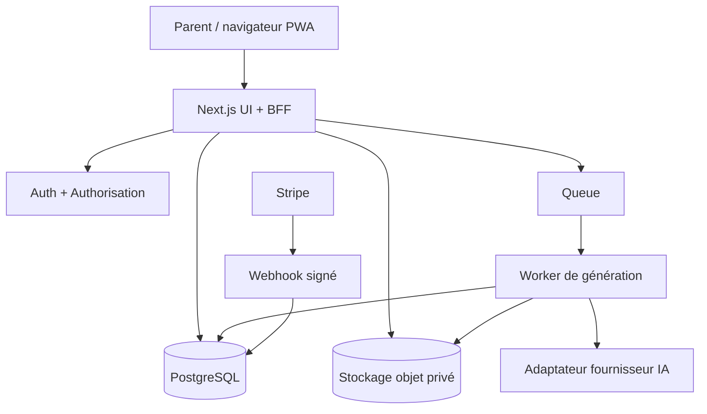

# Architecture cible (proposition)

## Choix de départ
Monolithe modulaire Next.js App Router / TypeScript, PostgreSQL/Prisma, stockage objet privé, queue et worker asynchrone pour images, fournisseur d'images via adaptateur, Stripe pour paiements. Éviter un NestJS séparé tant que la complexité ne le justifie pas.

## Modules
`auth`, `parents`, `children`, `avatars`, `catalog`, `books`, `generation`, `billing`, `admin`, `privacy`, `observability`. Chaque module expose services typés et accès DB contrôlé.

## Flux critique
Parent autorisé → demande de livre (clé idempotence) → transaction crée `PersonalizedBook` + `GenerationJob` → queue → worker vérifie droits, quotas, budget et consentement → génère scènes → stocke assets privés → transaction marque `ready` → lecture via URL temporaire.

## Décisions techniques
- Toutes les opérations privées valident `parentId` côté serveur.
- Assets privés ; URL signées courtes, sans exposer chemins permanents.
- Job découplé du HTTP ; retries bornés avec backoff, DLQ et mécanisme de reprise.
- Contrat `ImageProvider` abstrait pour benchmark et remplacement.
- Événements Stripe signés, idempotents, traités côté serveur.
- Pas de CDN public pour les photos et références sensibles.

## Évolutivité
Séparer le worker, puis les services, seulement après métriques de charge. L'architecture peut héberger un lecteur audio plus tard sans l'implémenter maintenant.
