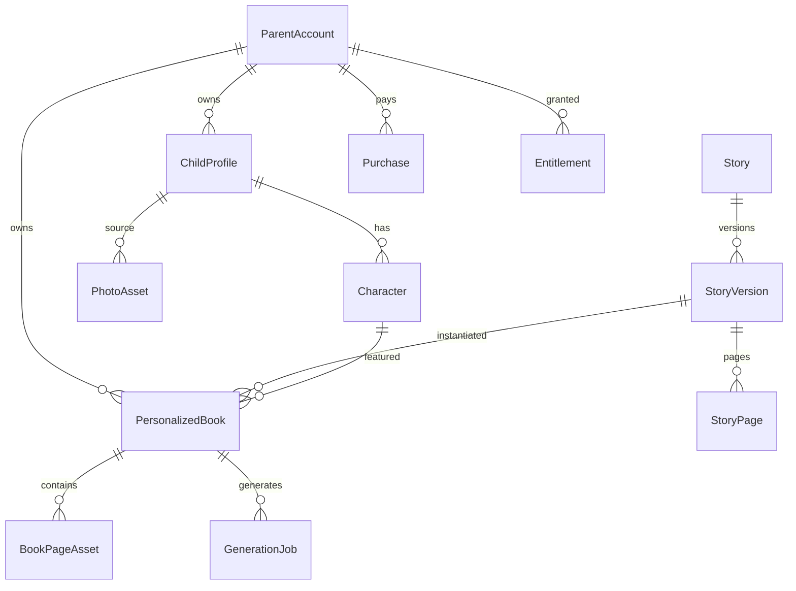

# Modèle de données conceptuel

## Entités et champs majeurs

| Entité             | Champs clés                                                                                | Contraintes                                                                                                                   |
| ------------------ | ------------------------------------------------------------------------------------------ | ----------------------------------------------------------------------------------------------------------------------------- |
| `ParentAccount`    | id, email, authProvider, createdAt, deletedAt                                              | email unique normalisé                                                                                                        |
| `ChildProfile`     | id, parentId, displayName, ageBand, grammaticalGender, status                              | propriétaire parent, minimisation ; grammaticalGender ∈ {masculine, feminine}, uniquement pour les accords du texte (ADR-006) |
| `ConsentRecord`    | id, parentId, childId, purpose, policyVersion, grantedAt, revokedAt                        | preuve et version, pas consentement implicite                                                                                 |
| `PhotoAsset`       | id, childId, objectKey, checksum, status, purgeAt                                          | privé, rétention limitée                                                                                                      |
| `Character`        | id, childId, styleVersion, referenceAssetId, status, approvedAt                            | référence dessinée validée                                                                                                    |
| `Story`            | id, slug, ageBand, theme, status                                                           | slug stable                                                                                                                   |
| `StoryVersion`     | id, storyId, version, locale, status, publishedAt                                          | unique(storyId, version, locale) ; locale ∈ {fr, de, en, ar} (ADR-006, accepté) ; direction (ltr/rtl) dérivée de la locale    |
| `StoryPage`        | id, storyVersionId, pageNo, textTemplate, sceneSpec, backgroundKey                         | unique(version, pageNo)                                                                                                       |
| `PersonalizedBook` | id, parentId, childId, characterId?, storyVersionId, status, lastPage                      | snapshot de version et propriété ; characterId optionnel = héros par défaut (ADR-007)                                         |
| `BookPageAsset`    | id, bookId, pageNo, objectKey, checksum, qualityStatus                                     | unique(bookId, pageNo)                                                                                                        |
| `GenerationJob`    | id, parentId, bookId, idempotencyKey, state, attempts, provider, estimatedCost, actualCost | unique(parentId, idempotencyKey) via owner explicite                                                                          |
| `Purchase`         | id, parentId, providerSessionId, amount, currency, state                                   | unique(providerSessionId)                                                                                                     |
| `Subscription`     | id, parentId, providerSubscriptionId, status, periodEnd                                    | unique(providerSubscriptionId)                                                                                                |
| `Entitlement`      | id, parentId, type, targetId, sourcePurchaseId, validUntil                                 | contrôlé serveur                                                                                                              |
| `AuditEvent`       | id, actorId, action, resourceType, resourceId, createdAt                                   | jamais de contenu image ou PII brute                                                                                          |
| `DeletionRequest`  | id, parentId, scope, state, requestedAt, completedAt                                       | purge orchestrée                                                                                                              |

## Relations

## Invariants

- `PersonalizedBook.parentId == ChildProfile.parentId == Character.childProfile.parentId` (si `characterId` présent).
- Un livre `ready` possède toutes ses pages validées.
- Aucune modification in-place d'une `StoryVersion` publiée.
- Toute suppression doit traiter les références objet et les tâches en cours.
- Un objet image n'est jamais référencé par une URL publique durable.
- Un statut de paiement n'est modifié que via événements authentifiés ou reconciliation autorisée.

## Rétention

Durées **à déterminer avec conseil juridique** : photo source courte, référence dessinée tant que nécessaire, livres selon contrat et suppression, logs minimisés, données de facturation selon obligations légales. La suppression des photos n'implique pas nécessairement l'effacement instantané de sauvegardes ; documenter fenêtres et exceptions.

## Index

`ChildProfile(parentId)`, `Character(childId,status)`, `PersonalizedBook(parentId,createdAt)`, `GenerationJob(state,nextAttemptAt)`, `StoryVersion(locale,status)`, `Entitlement(parentId,type,targetId)`.
