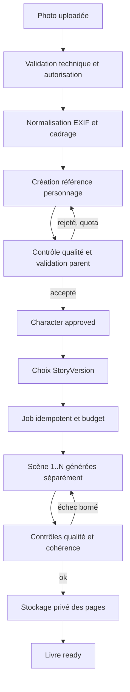

# Pipeline de génération d'images — spécification de référence

## Objectif

À partir d'une photographie autorisée, produire un **personnage de dessin animé ressemblant**, validé par le parent, puis des scènes distinctes d'histoires préécrites avec cohérence du héros. **La génération d'une planche unique n'est pas une preuve de cohérence entre appels indépendants.**

## Pipeline



## Étapes détaillées

1. **Upload** : format autorisé, taille/dimensions, type MIME vérifié, suppression EXIF, stockage privé et TTL de l'original à valider.
2. **Référence** : prompt de style maîtrisé, visage reconnaissable, tenue neutre, vue de face et idéalement planche d'expressions ; modèle et version enregistrés.
3. **Validation** : le parent accepte la référence ; refus entraîne régénération bornée et métrique d'échec.
4. **Scènes** : chaque page reçoit scène éditoriale, composition, référence du personnage, contraintes de pose, palette et liste négative (pas de texte, pas de logos, pas de visages supplémentaires non demandés).
5. **Contrôle** : image lisible, personnage présent, visage/cheveux cohérents (évaluation humaine entre images dessinées, jamais de comparaison biométrique avec la photo source), nombre de doigts acceptable, contexte conforme, aucun texte accidentel, sécurité enfants.
6. **Assemblage** : conserver image séparée du texte ; option composition par couches si le benchmark démontre une meilleure économie/qualité.
7. **Livraison** : images stockées une fois, checksum, métadonnées fournisseur, `ready` uniquement si toutes les pages passent le contrôle.

## Stratégies comparées

- A : générer chaque scène complète à partir de la référence. Forte expressivité, risque coût et incohérence.
- B : décors + personnage composés. Contrôle et coût meilleurs, mais interactions physiques artificielles.
- C : hybride A/B, choix par scène. **Stratégie proposée à évaluer**, pas décision validée.

## Interface de fournisseur

```ts
interface ImageProvider {
  createCharacter(input: CharacterRequest): Promise<ImageResult>;
  renderScene(input: SceneRequest): Promise<ImageResult>;
}
```

`ImageResult` doit fournir asset temporaire, modèle/version, usage facturable si disponible, durée et identifiant de requête. Ne jamais journaliser le contenu de la photo.

## Qualité — grille pilote (proposition)

Évaluer chaque scène sur 1–5 : ressemblance au sujet, cohérence avec référence, respect scène, qualité esthétique, absence d'artefacts. Deux évaluateurs humains si possible ; noter désaccords. Critères de go/no-go à fixer **avant** benchmark, pas après.

## Coût et robustesse

Coût livre = référence personnage amortie + somme des générations de scènes et régénérations + stockage + traitement. Limites par livre et par compte ; timeouts ; retries exponentiels bornés ; déduplication via clé `(characterVersion,storyVersion,locale,renderConfigVersion)` sous réserve de sécurité et droits ; DLQ.

## Risques fournisseur

Vérifier résidence des données, usage pour entraînement, durée de conservation côté fournisseur, droit d'effacement, sous-traitants, droits d'usage commercial, restrictions sur photos de mineurs et contenus générés. **Aucun fournisseur n'est approuvé dans ce dossier.**
